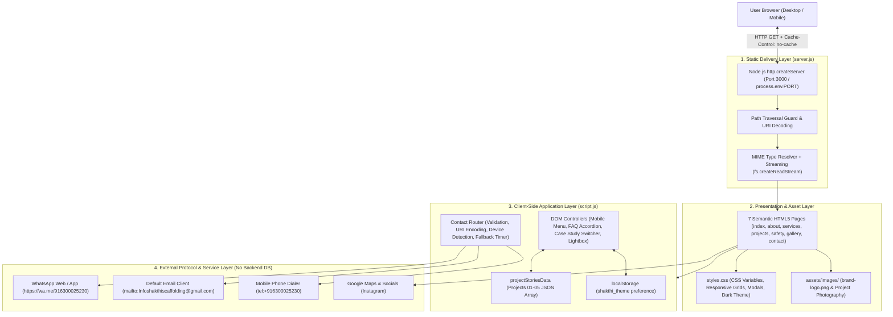
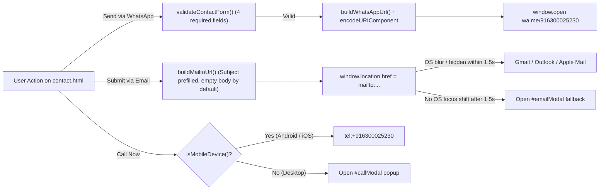

# Shakthi Scaffolding Website

Official multi-page business website for **Shakthi Scaffolding**, providing Cuplock scaffolding rental, installation, dismantling, and elevated access solutions across **Bangalore, Karnataka** (primary market) and **Andhra Pradesh** (Kadapa, Rayachoti, Rajampet, Anantapur, Kurnool, and surrounding regions).

---

## Tech Stack

- **Markup & Styling:** Semantic HTML5 and custom responsive CSS3 (`styles.css`) with light/dark theme support.
- **Client-Side Interactivity:** Vanilla JavaScript (`script.js`) — no build step or frontend framework required.
- **Local Development Server:** Zero-dependency Node.js HTTP static server (`server.js`) using built-in `http`, `fs`, and `path` modules.

---

## Technology Architecture

The application follows a **zero-build, static multi-page architecture** backed by a lightweight Node.js HTTP server for local serving and pure client-side JavaScript for UI state and external communication protocols (WhatsApp, Email, Phone Dialer).

### High-Level System Architecture



### Architectural Layers

1. **Static Delivery Layer (`server.js`)**
   - Uses Node.js core `http`, `fs`, and `path` modules with zero third-party npm packages.
   - Maps `/` to `/index.html`, strips query strings, decodes URI paths, and verifies `filePath.startsWith(__dirname)` before serving files to block directory traversal.
   - Resolves `MIME_TYPES` for `.html`, `.css`, `.js`, `.json`, `.png`, `.jpg`, `.svg`, `.ico`, `.webp`, and font files, streaming responses with `Cache-Control: no-cache, no-store, must-revalidate`.

2. **Presentation & Asset Layer (`*.html`, `styles.css`, `assets/images/`)**
   - Seven standalone SEO-tagged HTML pages share a consistent top info bar, responsive header/navigation, footer, and floating Call/WhatsApp buttons.
   - `styles.css` centralizes palette variables (`--navy`, `--blue`, `--orange`, `--yellow`, `--pale`), responsive breakpoints (`@media (max-width: 850px)`), `.dark-theme` overrides, and reusable `.modal-overlay` / `.modal-dialog` styles.

3. **Client-Side Application & State Layer (`script.js`)**
   - **Data Management:** `projectStoriesData` holds structured metadata (`image`, `number`, `title`, `location`, `type`, `position`, `work`, `region`, `result`) consumed by `#projectStoryTabs` on `projects.html`.
   - **Theme Persistence:** Reads and writes `shakthi_theme` (`'dark'` / `'light'`) in browser `localStorage`.
   - **Modals & Interactions:** Manages the gallery/case-study lightbox (`#lightbox`), FAQ toggles (`.faq-toggle`), mobile nav drawer (`#menuToggle`), desktop call modal (`#callModal`), and email fallback modal (`#emailModal`).

4. **External Communication & Fallback Architecture (`contact.html` + `script.js`)**
   - Operates serverlessly from the client using standard OS/browser protocol handlers so no backend mail server or database is required:



---

## Project Structure

```text
.
├── index.html          # Home page (hero, overview, selected work, service areas, FAQ)
├── about.html          # Company background, mission, and service coverage
├── services.html       # Cuplock scaffolding rental, erection, dismantling & industrial solutions
├── projects.html       # Interactive 01–05 project case-study switcher & proof stats
├── safety.html         # Safety standards, certified inspection & load compliance
├── gallery.html        # Project & site photography grid with modal lightbox
├── contact.html        # Quotation inquiry form (WhatsApp, Email, Call Now) & contact details
├── styles.css          # Global styles, responsive grids, modals, and dark theme rules
├── script.js           # Project switcher, FAQ accordion, theme toggle, lightbox & contact logic
├── server.js           # Static file HTTP server (defaults to port 3000)
└── assets/
    └── images/         # Brand logo (brand-logo.png) and site/project photography
```

---

## Pages Overview

| Page | File | Title |
| :--- | :--- | :--- |
| Home | `index.html` | Shakthi Scaffolding \| Scaffolding Rental & Installation in Bangalore & Andhra Pradesh |
| About | `about.html` | About Us \| Shakthi Scaffolding — Bangalore & Andhra Pradesh |
| Services | `services.html` | Services \| Shakthi Scaffolding — Bangalore & Andhra Pradesh |
| Projects | `projects.html` | Projects \| Shakthi Scaffolding — Bangalore & Andhra Pradesh |
| Safety | `safety.html` | Safety \| Shakthi Scaffolding — Bangalore & Andhra Pradesh |
| Gallery | `gallery.html` | Gallery \| Shakthi Scaffolding — Bangalore & Andhra Pradesh |
| Contact | `contact.html` | Contact \| Shakthi Scaffolding — Bangalore & Andhra Pradesh |

---

## Key Features

### 1. Contact & Quotation Actions (`contact.html` + `script.js`)
- **Send via WhatsApp:** Validates all four form fields (`contactName`, `contactPhone`, `contactProject`, `contactMessage`) and opens `https://wa.me/916300025230?text=...` with a formatted quotation request.
- **Submit via Email:** Opens the user's configured default email application (Gmail web handler, Outlook, Apple Mail, Thunderbird, etc.) using:
  `mailto:Infoshakthiscaffolding@gmail.com?subject=Quotation%20Request%20%7C%20Shakthi%20Scaffolding`
  - Leaves the email body empty by default so customers can write freely.
  - Set `INCLUDE_FORM_DETAILS_IN_EMAIL = true` in `script.js` if you want to enable automatic validation and body prefilling from the form fields.
  - Displays a fallback notice (`#emailModal` + inline status) if no email application handles the `mailto:` action.
- **Call Now (`data-call-action`):** Opens the native dialer (`tel:+916300025230`) on mobile devices and displays a clean phone number modal (`#callModal`) on desktop browsers.

### 2. Interactive Projects Showcase (`projects.html` + `script.js`)
- Powered by `projectStoriesData` in `script.js` and tabs `#projectStoryTabs` in `projects.html`.
- Defaults to **Project 01** (`Reliance Digital Commercial Scaffolding` — Near Koti Reddy Circle, Kadapa, Andhra Pradesh) on load, with tabs `01`–`05` switching dynamically:
  - **01:** Reliance Digital Commercial Scaffolding
  - **02:** Shirdi Sai Electricals Manufacturing Facility (Industrial Development Area, YSR Kadapa District)
  - **03:** Commercial Building External Scaffolding
  - **04:** Residential Apartment Scaffolding Project (Near Utukur, Prakruthi Nagar, YSR Kadapa District)
  - **05:** Smart Bazaar Commercial Building Scaffolding (Near Nehru Park, Smart Bazaar, Kadapa, Andhra Pradesh)

### 3. UI & Accessibility Helpers
- **Dark / Light Theme:** Persisted via `localStorage` under key `shakthi_theme` (`#themeToggle`).
- **Mobile Navigation Drawer:** Responsive hamburger toggle (`#menuToggle`, `#mainNav`).
- **FAQ Accordion (`index.html`):** All questions start collapsed (`aria-expanded="false"`) and expand smoothly on click.
- **Image Lightbox:** Full-screen photo preview on gallery cards and project case study images (`openLightbox` / `closeLightbox`).
- **Floating Quick Actions & Footer:** Quick call/WhatsApp floating buttons on every page plus footer links including `@shakthi_scaffolding` on Instagram.

---

## Running Locally

### Prerequisites
- [Node.js](https://nodejs.org/) installed on your machine.

### Start the Server
From the project root directory:

```bash
node server.js
```

Then open your browser and visit:
- Home: `http://localhost:3000/index.html`
- Projects: `http://localhost:3000/projects.html`
- Contact: `http://localhost:3000/contact.html`

You can override the default port (`3000`) via the `PORT` environment variable:

```bash
PORT=8080 node server.js
```

---

## Configuration & Maintenance

- **Business Contact Constants (`script.js`):**
  - `CONTACT_PHONE_E164`: `'916300025230'`
  - `CONTACT_EMAIL`: `'Infoshakthiscaffolding@gmail.com'`
  - `INCLUDE_FORM_DETAILS_IN_EMAIL`: `false` (flip to `true` to prefill form fields into the `mailto:` body)
- **Project Case Studies:** Edit `projectStoriesData` in `script.js` (and keep `#projectStoryTabs` / default `#caseStudyBox` in `projects.html` aligned with index `0`).
- **Logo Asset:** Replace `assets/images/brand-logo.png` (`1024x1024` PNG) when updating brand artwork across the header, footer, and favicon tags.

---

## Syntax Verification

Run Node's built-in syntax checks after modifying JavaScript files:

```bash
node --check server.js
node --check script.js
```

---

## Business Contact Details

- **Phone:** +91 63000 25230
- **Email:** Infoshakthiscaffolding@gmail.com
- **Instagram:** [@shakthi_scaffolding](https://www.instagram.com/shakthi_scaffolding?vrfl=NG5maXV0N280Njho)
- **Service Regions:** Bangalore (Karnataka) & Andhra Pradesh (Kadapa, Rayachoti, Rajampet, Anantapur, Kurnool)

